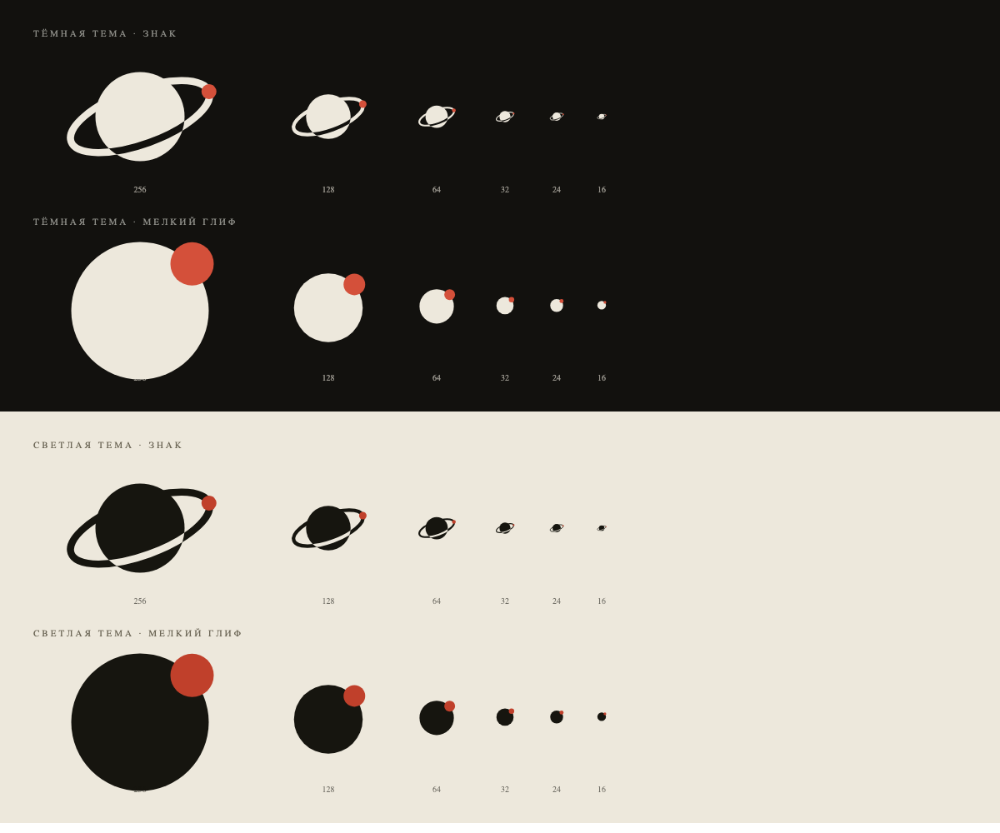

# Логотип Apolune

Знак: планета с кольцом и точка на орбите — «аполуна», самая дальняя точка лунной орбиты.
Кольцо проходит за планетой и вырезается спереди цветом фона.

## Файлы

| Файл | Для чего |
|---|---|
| `apolune-mark.svg` | знак для петроля `#2C4A47` (иконка, тёмные плашки) |
| `apolune-mark-dark.svg` | знак для тёмной темы `#12110E` |
| `apolune-mark-paper.svg` | знак для светлой темы `#EDE8DC` |
| `apolune-glyph-small-dark.svg` | мелкий глиф для тёмной темы |
| `apolune-glyph-small-paper.svg` | мелкий глиф для светлой темы |
| `icon-petrol-1024.png` | иконка приложения 1024×1024 |
| `preview-variants.png` | лист вариантов и размеров |

## Размеры

- **Знак** — от 32 px. На 24 и ниже кольцо сливается с планетой.
- **Мелкий глиф** — от 16 до 32 px: планета и точка без кольца, единственное, что читается
  в иконке 16×16.
- Иконка приложения — от 128 px.

## Цвета

| Роль | Светлая | Тёмная |
|---|---|---|
| Знак | `#16150F` | `#EDE8DC` |
| Вырез кольца | `#EDE8DC` | `#12110E` |
| Точка | `#C0402B` | `#D4503A` |

Вырез всегда равен фону: на другом фоне нужен свой SVG, иначе кольцо «проваливается».

## Правила

- Только однотонный фон: бумага, тушь, петроль. На фото и градиентах — нет.
- Свободное поле вокруг знака — не меньше высоты планеты.
- Не поворачивать знак, не менять наклон кольца, не перекрашивать точку в цвет фона.
- Логотип в сборе: знак + `APOLUNE` в Oswald 700, трекинг 0.16em; компоновки — в
  `design/prototype/lib/logo_main.dart`.

## Где применён

- macOS: `swift/App/AppIcon/IconBlue.icon/Assets/mark-white.svg` (заливка петроль).
- iOS: `swift/App/AppIcon/IconBlack.icon/Assets/mark-white.svg` (тёмная заливка, вырез под неё).

В интерфейсе: виджет `lib/pages/shared/widgets/apolune_brand.dart` (`ApoluneMark` + `ApoluneBrand`),
стоит в шапке онбординга. Цвета берутся из палитры темы, вырез кольца — из цвета фона, поэтому
знак работает и в светлой, и в тёмной теме без отдельных файлов.
